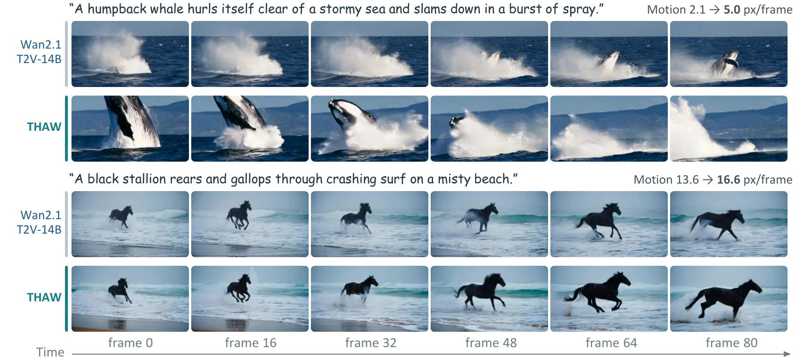
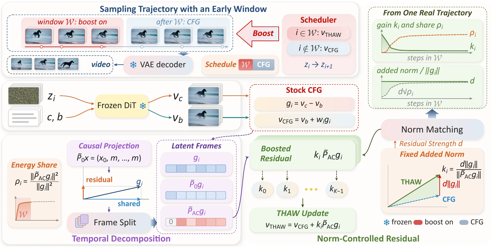

# Frozen by the Mean

## Early Temporal Guidance Unfreezes Motion in Video Diffusion Models

**THAW** adds a controlled frame-varying residual to classifier-free guidance during early denoising. It works with pretrained video diffusion models and reuses the two CFG predictions.

[Project page](https://xuanhuayin.github.io/THAW/) · [Paper PDF](https://xuanhuayin.github.io/THAW/THAW.pdf) · [Install](#installation) · [Run THAW](#quick-start) · [Reproduce the analysis](docs/reproduction.md)

*Selected paired examples from Wan2.1-T2V-14B. Both methods use the same prompt and sampling budget. The project page includes the corresponding videos.*

## Installation

Use Python 3.11 and a CUDA GPU with bfloat16 support. Install matching CUDA builds of [PyTorch 2.10.0 and torchvision 0.25.0](https://pytorch.org/get-started/previous-versions/), then run:

    python -m pip install -e '.[video]'

The first run retrieves the selected public checkpoint. Use `--local-files-only` for offline generation from your Hugging Face cache. Use `--checkpoint /path/to/checkpoint` with a compatible local Diffusers snapshot. Larger checkpoints need substantial host RAM and disk space. `--offload sequential` reduces GPU memory use.

## Quick start

    thaw --model wan-1.3b --prompt "A red kite loops over an open field." \
      --paired --seed 42 --output outputs/kite.mp4

This writes `kite_stock.mp4`, `kite_thaw.mp4`, and a JSONL configuration record. Both runs start from the same initial noise and keep the prompt, dimensions, and scheduler fixed.

For image-to-video:

    thaw --model wan-i2v-14b --image input.png \
      --prompt "The red kite rises as the wind picks up." --output outputs/kite_i2v.mp4

For a shorter installation check, append `--width 128 --height 128 --frames 9 --steps 4` to the Wan1.3B text-to-video command.

### Final settings

| CLI preset | Output (width × height) | Frames | Steps | CFG | Residual strength | Early window | Projection |
|---|---:|---:|---:|---:|---:|---:|---|
| `wan-1.3b` | 832 × 480 | 49 | 30 | 5 | 2 | 40% | Causal |
| `wan-14b` | 832 × 480 | 81 | 50 | 5 | 2 | 40% | Causal |
| `cogvideox-5b` | 720 × 480 | 49 | 50 | 6 | 3 | 40% | Full |
| `ltx-video-2b` | 704 × 512 | 161 | 50 | 3 | 4 | 20% | Causal |
| `hunyuanvideo-1.5` | 848 × 480 | 81 | 50 | 6 | 4 | 60% | Causal |
| `wan-i2v-14b` | 832 × 480 | 81 | 50 | 5 | 2 | 40% | Causal |

All presets pin a checkpoint revision. See [the evaluation protocol](docs/reproduction.md) for scheduler, decode, and reporting details.

## Method

For conditional and baseline predictions $v_c$ and $v_b$, THAW takes their difference $g=v_c-v_b$ and projects it onto the frame-varying residual $r$. While the initial window is active, the sampler adds $d\lVert g\rVert_2 r/\lVert r\rVert_2$ to its CFG prediction. The causal projection leaves the first latent frame's added term at zero. The update is implemented once in [`src/thaw/guidance.py`](src/thaw/guidance.py). Each adapter delegates conditioning, the scheduler, and decoding to its upstream pipeline.

### Batch generation

Each JSONL row carries an `id`, `prompt`, and optionally a `seed` or an `image` path relative to the JSONL file. Run the same command with `--prompts prompts.jsonl --output-dir outputs` in place of `--prompt` and `--output`. Use `--paired` to generate each prompt with both samplers.

### Tests

    python -m pip install -e '.[video,analysis,test]'
    ruff check src tests
    python -m pytest

The automated tests require no checkpoint downloads. The [reproduction guide](docs/reproduction.md) describes which measurements enter the statistics and how to supply a complete paired CSV.

## Checkpoints and attribution

THAW loads public checkpoints from [Wan-AI](https://huggingface.co/Wan-AI), [CogVideoX](https://huggingface.co/zai-org/CogVideoX-5b), [Lightricks](https://huggingface.co/Lightricks/LTX-Video-0.9.5) and the [HunyuanVideo community](https://huggingface.co/hunyuanvideo-community/HunyuanVideo-1.5-Diffusers-480p_t2v) through [Diffusers](https://github.com/huggingface/diffusers). The checkpoint providers' terms apply to their weights. The repository includes code, documentation, and selected qualitative assets.

## Citation

Xuanhua Yin, Boyu Wei, Chengkun Yue, Shunqi Mao, Chuanzhi Xu, Wei Guo, Weidong Cai. *Frozen by the Mean: Early Temporal Guidance Unfreezes Motion in Video Diffusion Models.* 2026. [PDF](https://xuanhuayin.github.io/THAW/THAW.pdf).
